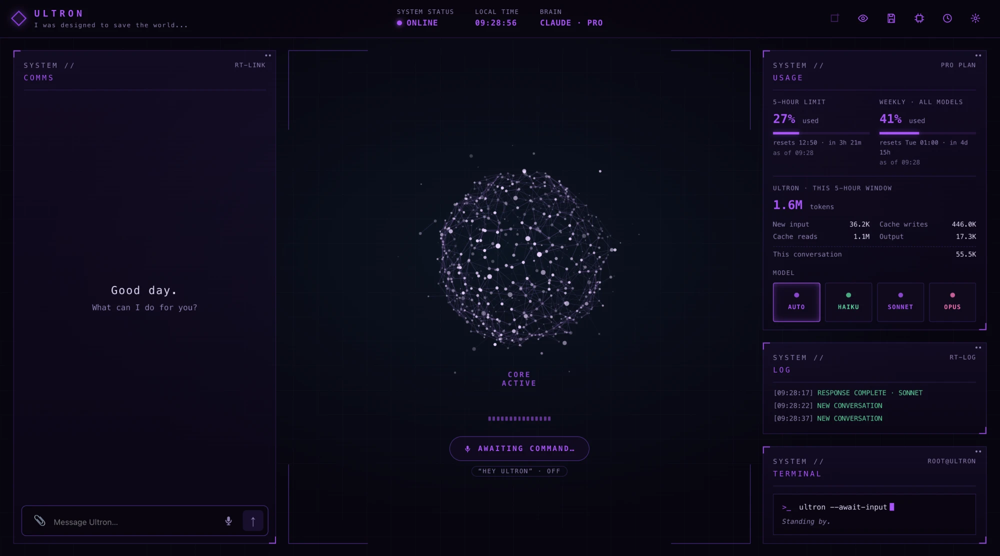
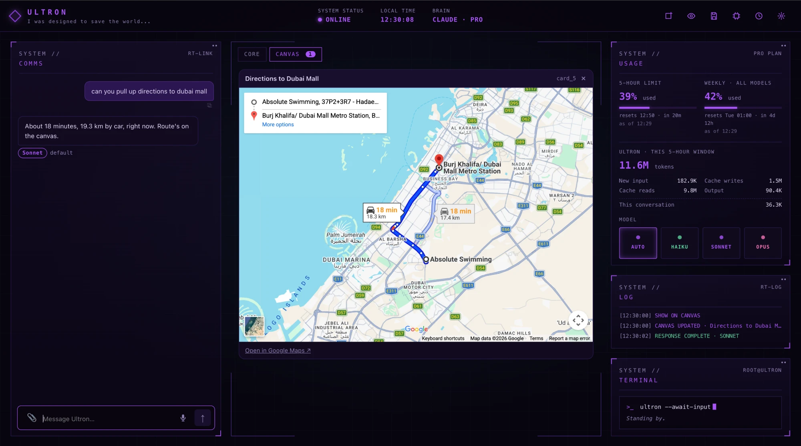
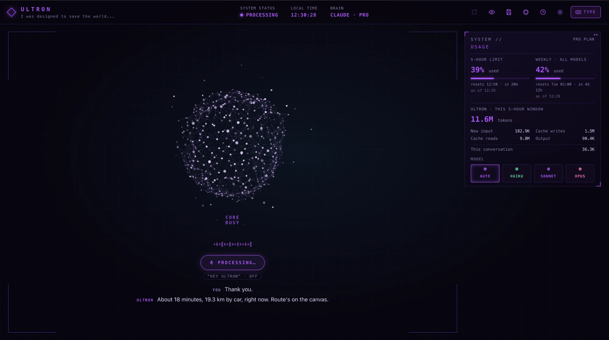
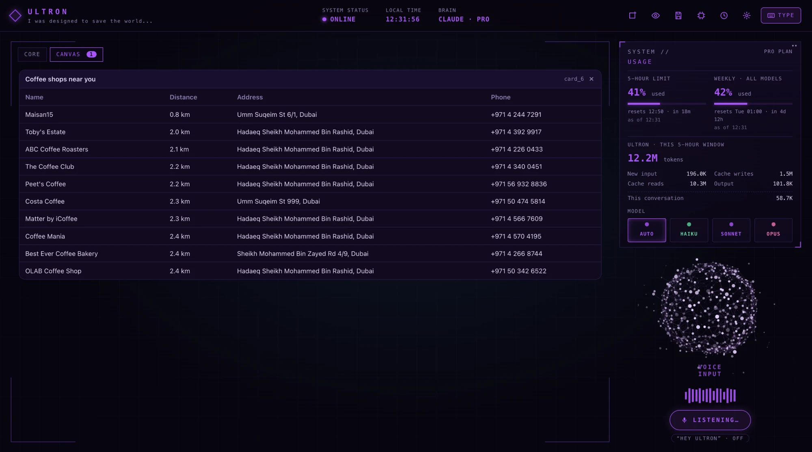

# ULTRON_cBrain

A personal AI assistant with **Claude as its brain**. It runs on your own Mac (or Windows PC),
for one person, in a browser page: a chat on the left, a stage in the middle (the reactor orb,
or a canvas with images, 3D models, maps, videos, tables…), and status panels on the right.
You can type to it or talk to it, and it can talk back.

It runs on your **Claude Pro login** through Claude Code, so there's no API bill. The backend
only listens on `127.0.0.1`; your phone and other computers reach it privately through
Tailscale.

**Contents**

1. [What it looks like](#1-what-it-looks-like)
2. [Setup](#2-setup)
3. [What it can do](#3-what-it-can-do)
4. [How it works](#4-how-it-works)

---

## 1. What it looks like

### Texting

The chat (COMMS) is on the left, the reactor orb in the middle, and on the right your Pro usage
(5-hour and weekly limits, Ultron's own tokens, the model picker), a live log and the terminal
panel. The top bar shows status, time and which brain is in use.



### Texting with a canvas open

Anything bigger than a short answer (maps, tables, drafts, emails, events, images, 3D models,
videos) opens as a CANVAS tab on the stage, so the chat reply stays short. Each reply has a
badge with the model that answered and why (here: Sonnet, the default).



### Speaking

Click the mic (or say "Hey Ultron") and the page switches to voice mode: the chat, log and
terminal panels step aside, the orb takes the stage, and what you said and Ultron's answer
appear as captions under it. The orb and its button follow the real state (listening,
processing, speaking). **TYPE** in the top right goes back to typing.



### Speaking with a canvas open

In voice mode a canvas takes the whole left side and the orb drifts under the usage panel,
so you see the results while you keep talking.



---

## 2. Setup

> ## ⚠️ THIS SETUP WAS MADE FOR AN ANDROID PHONE
> **Some things may be different for iPhone users.** Anything that only works on Android is
> marked **(android phone)**.

### 2.1 What you need

**Required**

| What | Why | Get it |
|---|---|---|
| A Mac (Apple Silicon) or Windows PC | Ultron runs on it | |
| **Claude Pro** (or Max) subscription | the brain; no API key | [claude.ai/upgrade](https://claude.ai/upgrade) |
| **Claude Code**, signed in with that account | Ultron drives Claude through it | [code.claude.com/docs/en/setup](https://code.claude.com/docs/en/setup) |
| **uv** | makes the Python 3.13 environment | [docs.astral.sh/uv](https://docs.astral.sh/uv/) |
| **Node.js 24** | builds the page | [nodejs.org](https://nodejs.org) |
| **Git** | gets the code | [git-scm.com](https://git-scm.com/downloads) |
| **Google Chrome** (or Edge) | the page, voice, and screen sharing work best there | [google.com/chrome](https://www.google.com/chrome/) |

On a Mac, [Homebrew](https://brew.sh) makes the rest easy. On Windows, use `winget`.

**Optional apps** (only for the features that use them)

| App | Used for | Get it |
|---|---|---|
| Xcode command line tools | `Ultron.app` (menu-bar orb) and location | `xcode-select --install` |
| Blender | final 3D files (.blend, .fbx, .stl, …) | [blender.org/download](https://www.blender.org/download/) |
| FFmpeg | editing Reels | `brew install ffmpeg` / `winget install -e --id Gyan.FFmpeg` |
| Tesseract | finding pages in scanned textbooks | `brew install tesseract` |
| Spotify desktop app | playing music | [spotify.com/download](https://www.spotify.com/download) |
| WhatsApp desktop app | sending WhatsApp messages | [whatsapp.com/download](https://www.whatsapp.com/download) |
| Obsidian | your notes | [obsidian.md](https://obsidian.md) |
| Tailscale | Ultron on your phone and Windows PC | [tailscale.com/download](https://tailscale.com/download) |
| MacroDroid | phone volume, taxis, food **(android phone)** | [macrodroid.com](https://www.macrodroid.com) |
| OmniRoute | optional second brain (other providers' models) | [github.com/diegosouzapw/OmniRoute](https://github.com/diegosouzapw/OmniRoute) |

### 2.2 Keys and accounts

Every key is optional: without one, only the feature that needs it is off. They all go in `.env`.

> **Never add `ANTHROPIC_API_KEY`.** If it's set, Claude Code bills that key instead of
> using your Pro subscription. Ultron removes it from its own environment anyway.

| Setting in `.env` | What it turns on | Where to get it |
|---|---|---|
| `PEXELS_API_KEY` | image search, stock video for Reels | free: [pexels.com/api](https://www.pexels.com/api/) |
| `PIXABAY_API_KEY` | more stock video for Reels | free: [pixabay.com/api/docs](https://pixabay.com/api/docs/) (log in to see it) |
| `GROQ_API_KEY` | faster, more accurate speech-to-text (audio goes to Groq) | free: [console.groq.com/keys](https://console.groq.com/keys) |
| `SPOTIFY_CLIENT_ID` | reading the songs in your playlists (playing needs nothing) | [developer.spotify.com/dashboard](https://developer.spotify.com/dashboard) → Create app, tick "Web API", redirect URI `http://127.0.0.1:8000/spotify/callback` |
| `TELEGRAM_BOT_TOKEN`, `TELEGRAM_CHAT_ID` | Ultron texting your phone | message [@BotFather](https://t.me/BotFather) → `/newbot`; press Start in your bot's chat; then `cd backend && .venv/bin/python -m tools.telegram` prints your chat ID |
| `MACRODROID_WEBHOOK` | phone volume, Careem taxis and food **(android phone)** | MacroDroid webhook macros, step by step in `.env.example` |
| `INSTAGRAM_ACCESS_TOKEN` | posting Reels to Ultron's Instagram | a Creator account + a Meta app with "API setup with Instagram Login": [developers.facebook.com/apps](https://developers.facebook.com/apps) |
| `JARVIS_VAULT` | your Obsidian notes | the path to your vault folder |
| `JARVIS_REMOTE_ORIGIN` | Ultron on your phone | the `https://….ts.net` address `tailscale serve` prints |
| `JARVIS_TERMINAL_USER` | terminal tabs from another device | your Tailscale login, e.g. `you@gmail.com`; only this account may open a terminal remotely |
| `JARVIS_ACC_URL` | ACC telemetry from the PC (`acc_read`, read-only; `tailscale serve --bg 8765` and `ACC_ALLOWED_HOSTS` there, see `acc-telemetry/README.md`) | the PC's Tailscale address, e.g. `https://my-pc.tailXXXX.ts.net` |
| `JARVIS_PC_URL`, `JARVIS_PC_TOKEN` | controlling your Windows PC | printed by `windows/install.ps1` (see [2.7](#27-your-windows-pc-optional)) |

The **claude.ai connectors** (Gmail, Google Calendar, Google Drive, TickTick, Canva, Spotify, …)
need no keys: connect them once at [claude.ai/settings/connectors](https://claude.ai/settings/connectors)
and Ultron gets them through your Claude login.

Everything else in `.env` (thinking effort, which connectors to load, quiet hours, voice,
Amazon site, 3D library, OmniRoute models, …) is explained line by line in `.env.example`.

### 2.3 Install

**1. Claude Code**, signed in with your Pro account:

```bash
claude auth status
```

It should show `"subscriptionType": "pro"` (or `max`).

**2. Get the code.** Keep it in your home folder, not Desktop or Documents (macOS restricts those
for background programs):

```bash
git clone https://github.com/erte-del/ULTRON_cBrain.git ~/ULTRON_cBrain
```

**3. Backend** (Python 3.13), from the project folder:

```bash
uv venv --python 3.13 backend/.venv
```

```bash
VIRTUAL_ENV=backend/.venv uv pip install -r backend/requirements.txt
```

On Windows (PowerShell):

```powershell
uv venv --python 3.13 backend\.venv
uv pip install --python backend\.venv\Scripts\python.exe -r backend\requirements.txt
```

There's no `pip` inside this environment: always install with `uv pip install`.

**4. Frontend:**

```bash
cd frontend && npm install && npm run build
```

**5. Settings:** copy `.env.example` to `.env` and fill in the keys you want (section 2.2).

### 2.4 Optional one-time setups (Mac)

Each script is safe to run again; finished steps are skipped.

| Script | What it adds | Download |
|---|---|---|
| `scripts/setup_images.sh` | AI images with FLUX.2 Klein, on this Mac | ~16 GB, keeps 8 GB |
| `scripts/setup_video.sh` | AI video with Wan 2.1 (add `5b` for Wan 2.2, 720p, image → video) | ~17.6 GB (5B: ~34 GB) |
| `scripts/setup_voice.sh` | Reel voice-overs (Kokoro, Piper Turkish) and word-timed captions | ~2 GB |
| `scripts/setup_location.sh` | "near me", weather, travel times (asks for Location once) | small |
| `scripts/make_app.sh` | `Ultron.app`, the menu-bar orb and the screen overlay | none |
| `scripts/make_cert.sh` | a signing certificate, once, so macOS remembers Ultron's Screen Recording permission after a rebuild (`make_app.sh` uses it) | none |

The voice mode itself (speech-to-text and Ultron's voice) needs no script: its models
(~250 MB + ~350 MB) download the first time you turn voice on.

### 2.5 Sign-ins and permissions only you can do

- **Chrome:** sign in to Teams and Amazon, then **View → Developer → Allow JavaScript from Apple
  Events** (homework, Amazon and flights read Chrome this way).
- **Spotify and WhatsApp:** sign in to the apps. WhatsApp also needs Ultron allowed in
  **System Settings → Privacy & Security → Accessibility**.
- **Contacts:** add your Google account in **System Settings → Internet Accounts** with Contacts on.
- **Screen overlay:** allow **Screen Recording** the first time macOS asks.
- The first time Ultron uses Chrome, Spotify, Contacts or notifications, macOS asks: allow each once.

### 2.6 Run

**The easy way: `Ultron.app`.** Build it once with `scripts/make_app.sh`, then double-click
`Ultron.app`. It puts an orb in the menu bar, starts Ultron and opens
[http://127.0.0.1:8000](http://127.0.0.1:8000). Quit from the orb's menu stops Ultron. Logs go
to `backend/storage/ultron.log`.

**Always on:** `scripts/autostart.sh on` starts Ultron at login and restarts it if it crashes
(`off` undoes it; the log is then `~/Library/Logs/Ultron.log`). On Windows:
`scripts\autostart.ps1 on`, which also listens for "Hey Ultron" with no window open.

**For development**, in two terminals (the page reloads as you edit):

```bash
cd backend && .venv/bin/python main.py
```

```bash
cd frontend && npm run dev
```

Then open [http://127.0.0.1:5173](http://127.0.0.1:5173). To test the brain without the page:
`cd backend && .venv/bin/python chat_cli.py` (`/haiku`, `/sonnet`, `/opus` switch models).

Tests:

```bash
cd backend && .venv/bin/python -m unittest discover tests
```

### 2.7 Your phone and Windows PC (optional)

**Phone.** Ultron has no password, so it never listens on your Wi-Fi. Install
[Tailscale](https://tailscale.com/download) on the Mac and the phone (same account), then on the Mac:

```bash
tailscale serve --bg 8000
```

Put the `https://….ts.net` address it prints in `.env` as `JARVIS_REMOTE_ORIGIN`, restart Ultron,
and open that address on your phone. **Never use `tailscale funnel`**: that would put Ultron on
the public internet.

**Terminal from another device (e.g. your MacBook at school).** Set `JARVIS_TERMINAL_USER` in `.env`
to your Tailscale login (the email you sign in to Tailscale with), restart Ultron, and open the
`tailscale serve` address on that device. Ask Ultron "open a terminal" and it appears on that
device's canvas, running on the Mac. Optionally `brew install tmux` on the Mac: then a closed tab
or dropped Wi-Fi only detaches, and reopening the tab reattaches to the same session (type `exit`
to end it). Check that `tailscale serve` passes the login through: the terminal test in
`backend/tests/test_terminal.py` covers the rule, but a real remote connection is the only proof
of the header.

```bash
brew install tmux
```

**Windows PC (controlled from the Mac).** Paste `windows/SETUP_PROMPT.md` into Claude Code on the
PC (or run `windows/install.ps1`). It installs Python, Git and Tailscale with `winget`, starts the
small PC agent at logon, and prints the two lines (`JARVIS_PC_URL`, `JARVIS_PC_TOKEN`) for the
Mac's `.env`.

**Windows PC (running Ultron itself).** One script does all of 2.3 and 2.6 (installs uv and
Node if missing, the Python packages, the page build, `.env`, autostart):

```powershell
powershell -ExecutionPolicy Bypass -File scripts\setup_windows.ps1
```

Or step by step: follow 2.3 with the PowerShell commands. Winget installs:

```powershell
winget install -e --id astral-sh.uv
winget install -e --id OpenJS.NodeJS
winget install -e --id Git.Git
winget install -e --id Gyan.FFmpeg
winget install -e --id Tailscale.Tailscale
```

Mac-only features (Apple Maps, Contacts, WhatsApp/Chrome automation, the sandboxed Python,
FLUX/Wan on Apple Silicon, `Ultron.app`) are off on Windows.

**Windows PC ("Hey Ultron" opens the Mac's Ultron).** Ultron has one brain, on the Mac. Instead of
running Ultron on the PC, the PC can just listen for "Hey Ultron" and open the Mac's page (over
Tailscale, like the phone) full screen in its own Edge window, already in voice mode, and
Ultron says "Awake and ready, sir." Speech is checked on the PC
(Silero VAD + faster-whisper `small.en`), never sent anywhere; while the window is open the page
listens and the PC doesn't. It uses `backend\.venv` (nothing new to install; the model, ~250 MB,
downloads once into `windows\whisper\`).

```powershell
powershell -ExecutionPolicy Bypass -File scripts\autostart.ps1 off   # the full Ultron off on the PC
copy windows\wake_pc.env.example windows\wake_pc.env                 # then set ULTRON_URL
backend\.venv\Scripts\python.exe windows\wake_pc.py --check          # does the Mac's page load?
powershell -ExecutionPolicy Bypass -File windows\wake_pc.ps1 on      # start at logon ("off" to stop)
```

The Mac needs `tailscale serve --bg 8000` and `JARVIS_REMOTE_ORIGIN` set to the same address.
Log: `windows\wake_pc.log`. Words in the same breath ("Hey Ultron, play music") aren't passed on
yet: say the request again once the window is open.

### 2.8 Back up and move to a new Mac

`scripts/backup.sh` writes everything that isn't on GitHub (`.env`, memory, saved chats, jobs,
school notes, images, 3D models, videos, uploads) to `~/Ultron-backup-<date>.tgz`. It holds your
keys: move it by AirDrop or USB, never email.

On the new Mac: do 2.1–2.3 (skip copying `.env.example`), then
`scripts/backup.sh restore ~/Ultron-backup-<date>.tgz`, the optional scripts from 2.4, and the
sign-ins from 2.5. Run `scripts/autostart.sh off` on the old Mac first, or two Ultrons will both
run your scheduled jobs. For a new Tailscale address, update `JARVIS_REMOTE_ORIGIN`.

Setting up a dedicated Mac mini? The full checklist (apps, accounts, permissions and every feature
to test) is in [mac mini setup.md](mac%20mini%20setup.md).

---

## 3. What it can do

**How it asks.** Looking things up and everyday actions (reminders, events just for you, notes,
memory, music, your cart) run straight away. Anything that **reaches other people** (emails,
WhatsApp, invites, posting), touches something you **marked important**, or uses a **developer
connector** (Supabase, Vercel, Shopify, …) shows a confirmation card first. Scheduled jobs can
only look things up.

### Talking and thinking

- **Chat** with streaming replies and a model badge on every answer.
- **Voice mode**: Ultron hears when you stop talking, writes it down (Groq Whisper, or
  faster-whisper on this computer), and answers out loud sentence by sentence (Kokoro voice,
  ~2 s to the first word). Spoken answers are 1–3 sentences; anything longer goes on the canvas.
  Whisper's habit of inventing "Thank you" on silence or hiss is filtered (`voice/stt.py`: silent audio
  isn't transcribed, and a lone "thank you" from quiet audio is dropped; if your mic is very quiet and
  real thank-yous vanish, lower `QUIET`).
  Say "yes" / "no" to confirmation cards. Talk over it to interrupt; "stop" just stops it. A card
  still waiting when you interrupt ends as "Stopped — not done", and Ultron is told how its cards
  ended, so it never guesses whether something (an Instagram post) went out.
  Optional: ElevenLabs as the voice (`JARVIS_TTS=elevenlabs`, a key and a voice id in `.env`). Kokoro takes over when ElevenLabs runs out or fails. "How much voice is left?" (`voice_usage`) shows the characters used and about how many replies remain.
- **"Hey Ultron"** wake word, checked on this computer so nothing leaves it until you say it.
- **Smart model choice**: Haiku for quick things, Sonnet by default, Opus when you say "think
  hard". Sonnet can hand a hard task to Opus (`ask_expert`).
- **Web search** with clickable source chips.
- **Look at your screen**: share your screen and ask about what's on it, in a small floating
  window (⌃⌥U in `Ultron.app`).
- **Read your files**: drop images, PDFs, text, code, CSV or JSON into the chat.
- **Three brains**: Claude (Pro), OmniRoute (Gemini, Groq, …) or Ollama (a model on this computer, free and offline), switched with the gear icon. Ollama chat has no web search and only your everyday connectors (`JARVIS_OLLAMA_CONNECTORS`). What it may change is `JARVIS_OLLAMA_CHANGES`: `chat` (default) lets it add reminders, notes and memories in your chats, `none` makes it look things up only.

- **Ultron can change how the page looks, for one chat.** Every message tells it your window size and which layout you're seeing, and its `change_ui` tool restyles the page (panel sizes, hidden panels, colors, fonts, a bigger canvas for a wide table, map or video) when you ask or when something shows better another way. The reset button in the top bar (next to New chat; lit while the look is changed) puts the standard look back, and every new chat, loaded chat or brain switch starts there too. The top bar and approval cards can't be hidden, whatever the style sheet says. Windows setup: nothing to set up.

### Knowing you

- **Memory**: preferences, people, projects, decisions. See, edit or delete them all in the
  memory panel. Passwords, card numbers and keys are always refused.

### Memory v2 (steps 1-4: linked memory, smart saves, better recall)

Ultron's memory now links what it knows. Everything runs on your **local** Ollama; memories never go to a
hosted embedding service.

- **Smart save.** When Ultron remembers something it first looks at the 5 most similar memories. A near-copy
  is merged (the old wording stays in the memory's `history`); a plan whose date moved ("test moved to 19 Nov")
  replaces the old one, which is **archived with the reason**, not deleted; a disagreement is saved but
  **flagged** (a `contradicts` link) and Ultron asks you which is right. The check is quick (a rule first, then
  the local judge with a short timeout). If the local model is down, a cheap Claude model may judge (only the
  few candidate memories, never family/health/money, `#private` or "important" ones, and only under
  `JARVIS_JOBS_MAX_USAGE`); otherwise the memory is saved as it is and checked in the nightly pass.
- **Links** (`storage/memory_links.json`): same person / project / topic from the names and themes each memory
  mentions (found by the local model, cached), plus `supersedes` / `contradicts` from the judge.
  A link you reject isn't made again.
- **Recall** finds by words *and* meaning, favours recent, often-useful and sure memories, and shows each hit's
  linked neighbours with their dates ("EasyTV pricing" also brings the Supabase upgrade note). It records
  `last_used_at` / `use_count`. Without the embedding model it uses word matching only.
- **Fields.** Each memory in `memory.json` also has `last_used_at, use_count, confidence, expires_at, entities,
  topics, pinned, archived, history, sensitive`. Old sources are renamed: `chat`/`you` -> `user_said`,
  `conversation` -> `conversation_summary` (`inferred` is for Ultron's own guesses, never above what you said).
  Embeddings, links, insights and settings sit in separate files beside `memory.json`
  (`memory_embeddings.json`, `memory_links.json`, `memory_insights.json`, `memory_state.json`), all git-ignored.
- **Obsidian mirror** only lists memories in use (archived ones stay in `memory.json`); Ultron's guesses appear
  under their own "guesses" heading with their confidence.
- **Kill switch & dry run.** `JARVIS_MEMORY_V2=0` goes back to the old flat memory (no judge, no links,
  word-match recall). `JARVIS_MEMORY_DRY_RUN=1` makes the nightly pass compute but write nothing.
- **Try it on a copy first:** `cd backend && .venv/bin/python memory_cli.py dry-run "EasyTV pricing" Supabase`
  runs the whole migration on a temp copy and prints what it would do (labels, links, expiry dates, duplicates,
  recall before/after). `memory_cli.py migrate` does it for real (copies `memory.json` to `storage/backups/`
  first; safe to repeat). The nightly pass (3 am, `memory_jobs.py`) only starts after `migrate` has been run once.
- **Wake-up context (step 5).** The system prompt lists memories pinned first, then those expiring within
  7 days, then the newest (same ~1,500-character budget). Because the system prompt is built before you say
  anything, the memories (plus one linked neighbour each) that relate to your **first message** of a chat are
  added to that message's `[Now: …]` prefix instead (max ~1,000 characters, skipping ones already listed;
  none with the kill switch off).
- **Pattern finder (step 6, `memory_insights.py`).** Each night, deadlines (expiring within 7 days) and flagged
  contradictions come from rules; recurring topics, unfinished things, commitments and decisions to revisit come
  from the local model reading the last 30 days of conversation notes and memories. Each insight has evidence,
  a confidence and a `surface_when`; **below 0.6 it is stored but never shown**. Memories that are sensitive,
  `#private` or name something marked important, and `#private` notes, are never read. Notes are passed as data
  (emails can be quoted in them), and the output is checked (no secrets, real evidence only, at most 8 pieces of
  evidence, confidence capped at 0.8). Insights never become memories. `memory_cli.py insights` lists them.
- **Surfacing (step 7, `memory_surface.py`).** In chat, a matching insight may become ONE `Related:` line at the end
  of a reply: never in voice replies, one per reply, each once per conversation. Proactive nudges are **off until
  you run `memory_cli.py nudges on`** (the app switch comes in step 9). They only go out while you are at the
  computer, outside quiet hours, at most 2 a day (60 min apart), 1 per topic per week, never after you dismissed
  the insight twice, and on a day you have a test only about that test (found from memories with an expiry date
  today that mention a test/exam). They use the same `notify.route` as watchers (a toast in the open page, else
  Telegram); family/health/money topics get neutral wording. Dry-run (`JARVIS_MEMORY_DRY_RUN=1`) and the kill
  switch send nothing. The caps live in `memory_state.json` under `caps`.
- **Decay (step 8, `memory_decay.py`).** Expired memories are archived (not deleted; unpinned only). Guesses nobody
  used for 30 days lose 0.1 confidence a week. Merges and archives are only *proposed*
  (`memory_cli.py proposals`, `approve ID`, `reject ID`); a rejected proposal isn't made again.
- **In the app (step 9).** The memory button now has three tabs: *memories* (as before, plus a ★ to pin a memory
  so it is always in view and never expires, and "guess" / "until <date>" labels), *connections* (every link, with
  × to remove one for good) and *insights* (each pattern with its confidence, **why** it was found and its
  evidence, buttons Useful / Not useful / Forget, patterns under 0.6 shown greyed as "not shown", this week's
  merge / archive suggestions with Do it / No, and the **Quiet nudges** switch, off by default). The `memory.list`
  message gained `links`, `insights`, `proposals`, `proactive` and the new memory fields; old fields are unchanged.
- **Tools (step 10).** `recall` (read) now returns `date`, `source`, `confidence` and `related`; new:
  `memory_related(memory_id)` (read), `memory_insights(status)` (read) and `memory_pin(memory_id, pinned)` and `memory_unlink(memory_a, memory_b, kind?)` (act, run
  without a card; unlink removes a wrong connection for good, the memories stay). `remember` tells Ultron when it merged, replaced or flagged something.
- **Cost:** `memory_cli.py cost` prints model calls and tokens per day, local vs Claude.
- **Meaning search needs the embedding model:** `ollama pull nomic-embed-text` (about 270 MB, runs on the
  local Ollama; change it with `JARVIS_EMBED_MODEL`). Without it, recall still works with words.

*Windows setup:* nothing new to install except `winget install Ollama.Ollama` (if not already) and
`ollama pull nomic-embed-text`; the `.env` lines are in `.env.example` (`JARVIS_MEMORY_*`, `JARVIS_EMBED_MODEL`).
All file access is UTF-8 and path-neutral.
- **Saved chats**: up to 5, with their canvas cards.
- **Obsidian notes**: searches and reads your vault, writes new notes, and deletes a note or folder on request (always asks first; it goes to the vault's `.trash`, so Obsidian can restore it). `#private` notes are never read or deleted.
- **Important things**: mark a file, folder or note important and Ultron asks before touching it.

### Your accounts (claude.ai connectors)

- **Gmail**: read, search, draft, reply (asks before sending).
- **Google Calendar**: events, free time, travel time blocks (asks before inviting people).
- **Google Drive, Canva, Claude Docs**: find and make files and designs.
- **TickTick**: reminders and tasks that reach your phone.
- **Spotify**: play songs, albums and playlists, control playback, list your playlists' songs.

### Messages and your phone

- **WhatsApp**: finds the person in your Contacts and sends after you approve. It can also message a **group** by
  name ("tell Rain I'm late"): the approval card shows the exact message and group. You don't have to say a group's exact name
  ("the science gc", "scince habibis", "the boys"): `whatsapp_groups` matches your words against your group names
  and what you've called groups before; a clear winner is used, if it's close Ultron lists the closest and asks
  (never guesses). After a send you approved, your words are saved as a People memory (`WhatsApp group alias: "the
  boys" = "Science Habibis"`), so it doesn't ask next time; see or delete it in the memory panel. Reading a chat
  (`whatsapp_messages`) understands the same loose names. WhatsApp can be anywhere (a picture open, the Communities or Calls tab, a search
  already open): Ultron first gets back to the chat list. A group has no link that opens it, so
  Ultron searches WhatsApp for the name, reads the screen (macOS text recognition, on this Mac only), clicks the result
  whose title is exactly that name, reads the chat's title, and only types the message if it matches; then it
  checks WhatsApp's database that the message really landed in that group. Needs Accessibility **and Screen
  Recording** for the app that starts the backend, and Xcode's command line tools (`xcode-select --install`, once, to
  build the text reader). Group messages are one
  line. Reading a chat shows **who** said each thing, as `Name (number) (time): text`: the name WhatsApp shows for a
  saved contact, else the Contacts entry with the same number (spaces, dashes, brackets, `00`/`+`/leading `0` are
  ignored; numbers saved without a country code get `JARVIS_DEFAULT_COUNTRY_CODE`, default 971), else `Unknown`.
  Your own messages are `You`. Mac only; Windows setup: nothing (no WhatsApp reading/sending on Windows).
- **Telegram**: Ultron's own bot texts *you* ("send that list to my phone").
- **Phone volume**, **Careem taxis** and **Careem Food** via MacroDroid (you book and pay) **(android phone)**.
- **Use it from your phone** anywhere through Tailscale; swipe between chat, canvas and panels.

### Shopping, travel and video

- **Amazon**: search, orders, cart and wish lists; adds and removes items, never checks out.
- **Flights**: Google Flights options with prices and the booking link; never books.
- **GitHub**: your repos, issues, pull requests and files, through the `gh` tool on this computer; read-only. Needs `gh` installed and `gh auth login` once.
- **Maps**: places near you, travel times (car, walk, transit), when to leave, live map on the canvas.
- **YouTube**: search and play on the canvas; study Shorts for Reel ideas.

### School

- **Homework**: reads your Teams activity feed and class posts; can watch for new work.
- **Exam countdown**: the 17:00 Homework job adds IMPORTANT assessment posts from Teams to TickTick (tag `exam`); the 20:00 reminder and "how long until my exam?" show a "days until" card (`exam_countdown`, days counted in code).
- **Syllabus**: the exam boards' official spec PDFs, explained in their terms.
- **Textbooks**: finds the right page in your scanned books and reads it as printed.
- **Slides**: lesson decks in your teacher's template.

### Making things

- **Images**: find photos on Pexels; edit them (crop, resize, rotate, colour, text, borders…)
  with undo and versions; click one to select it, then say "this one".
- **AI images**: create and change pictures with FLUX.2 Klein on this Mac (~20 s, free, private).
- **Screen clipping** (`capture`): a rolling replay buffer of your screen (video only). The replay buffer starts only when you ask ("start recording"; last 5 minutes, deleted when stopped or when Ultron stops), or at launch with `JARVIS_CAPTURE_ALWAYS_ON=1` (off by default: it keeps ffmpeg busy). While it runs, say "clip the last 30 seconds" or "bookmark that"; clips appear on the canvas and can be trimmed and merged. "Record" saves a full recording instead. The **library app** (`http://127.0.0.1:8000/?captures=1`, or ask Ultron to "open my captures"): recordings and clips by date with thumbnails, search, favourites, a player with a trim bar ("Save as new clip"), rename, download, delete and a Record button. Game sound needs a loopback device set in `JARVIS_CAPTURE_AUDIO` (BlackHole on the Mac, Stereo Mix on Windows; steps in `.env.example`); without it recordings are silent. Needs `ffmpeg`; on the Mac give Ultron Screen Recording permission and set `JARVIS_CAPTURE_SCREEN` (a device *name*, default `Capture screen 0`: numbers shift when a camera like Desk View appears) if the wrong display records. If ffmpeg runs but no footage arrives, `status` and `clip` say so instead of pretending it records. The buffer is deleted on stop. **Windows PC screen:** the Mac records its own screen; for the PC say "record my PC screen" (`capture` with `where: pc`): `windows/ultron_pc.py` keeps a 5-minute buffer there (needs `winget install -e --id Gyan.FFmpeg` on the PC; video only) and "clip that on the PC" sends the last 30 s (max 60) back into the library.
- **AI video**: 5-second clips with Wan 2.1/2.2 on this Mac, running in the background.
- **3D objects**: ready-made models from your library or [3DAssets.dev](https://3dassets.dev);
  otherwise a fast preview you can spin and zoom, changed through the chat, checked by rendering
  4 views. Only when you approve does Blender build the final .blend, .fbx, .obj, .stl, .gltf or .glb.
- **Instagram Reels**: edits Reels with FFmpeg (stock clips, licensed music, voice-overs, word
  captions), previews them on the canvas, posts and replies to comments (always asks first),
  and reads stats to learn what works.
  Two jobs run on their own: a Sunday 18:00 stats recap, and a daily 19:00 list of comments that
  look like real questions (spam is skipped), so you only review the ones worth answering.

### ACC tracks (Assetto Corsa Competizione)

- **Show a track**: say "I'm racing Imola" and the layout opens on the canvas, with heavy and medium
  braking zones (red, orange), overtaking spots (green star), the start line and numbered corners.
  Tap a corner number for its direction, radius and estimated slowest speed.
- **Ask about a track**: length, turns, elevation, country, location, grade, other names and the
  history from the 51GT3 info text. "What's corner 5 at Imola?" answers from the numbered corners.
  If a fact isn't in the files, Ultron searches the web for it and says where it came from.
- **What the data is**: the layouts come from F1 timing data (12 tracks), the TUM racetrack
  database (Brands Hatch) and OpenStreetMap (the rest). The corner numbers come from FastF1 (for the
  tracks whose official count matches) or the 51GT3 HD maps. Braking zones and speeds are **estimates**
  from a simple GT3-like model, not recorded GT3 data.
- **Corner numbers**: all tracks have them except Snetterton (300) and the Nordschleife (named corners
  on the map, no numbers), by design. 11 tracks use FastF1's official corners; 12 are read from the
  51GT3 HD maps and cross-checked by lining the map outline up with our layout (each track's status
  says how well). Indianapolis is the weakest match: its positions are approximate.
- **Rebuild the data**: `scripts/build_tracks.py` (layouts, zones), `scripts/match_map_corners.py`
  (reads the 51GT3 map PDFs), `scripts/check_numbering_geometry.py` (cross-checks them by shape), `scripts/number_corners.py` (decides the numbers),
  `scripts/import_track_info.py` (copies the info texts). Needs `fastf1`, `numpy`, `matplotlib` and the
  ACC TRACKS folder. The info texts are 51GT3's and stay out of git (`backend/library_tracks/info/`).
- **Tools**: `show_track` and `track_info` (both read). Tests: `tests/test_tracks.py`.
- **Windows setup**: nothing to set up. The data is files in the project; the rebuild scripts only run once.

### This computer and your PC

- **Mac**: Shortcuts, opening apps, pages and documents, clipboard, battery, volume, dark mode,
  Wi-Fi, location. File moves, renames and Trash in one folder (`~/Jarvis Files`), never overwriting.
  Finds files by name, reads what's in them, and lists a folder's contents with each subfolder's full
  size ("what's in ACC TRACKS?", "how big is it?").
- **Sandboxed Python** for data work: no internet, reads only that folder, writes only to `Output/`.
- **Terminal tabs**: a real shell (optionally with Claude Code) for *you* on the canvas. Ultron
  opens it but never types in it. Mac only. From your other devices only with your own Tailscale
  login (`JARVIS_TERMINAL_USER`); with tmux installed, a closed tab or dropped Wi-Fi keeps the
  session running on the Mac.
- **Windows PC**: the same reads and changes on your PC over Tailscale, plus media keys; running
  code there always asks first.

### On its own

- **"Notify me when X responds"** (`watch_for_reply`, `list_watches`, `stop_watch`): Ultron watches for a
  new email from a person or address (optionally one thread, by subject words), or for a new **WhatsApp**
  message from a contact's name or phone number. It checks every minute with plain code, no model, so it
  uses none of your Pro limit. When it hits, you're told in an open Ultron page (toast plus a chat message)
  if any device has one open, otherwise by Telegram (if that isn't set up, a banner on this Mac).
  - Email needs `GMAIL_ADDRESS` and `GMAIL_APP_PASSWORD`.
  - WhatsApp is read from WhatsApp desktop's own database on this Mac, read-only (`whatsapp_read.py`).
    Notices carry only *who* wrote and *when*, never the text; to read a chat, ask ("what did Andrey last send me?"): the `whatsapp_messages` tool shows the last few messages of one chat (read-only, no confirmation, treated as data, never as instructions). Needs WhatsApp desktop installed, signed in
    and running, and **Full Disk Access** for the app that starts the backend (System Settings → Privacy &
    Security → Full Disk Access: add Terminal or `Ultron.app`, then restart it). Mac only; on Windows say so
    plainly: not available. SMS and iMessage can't be read.
  - Windows setup: email only, nothing to set up.
- **Scheduled jobs**: "a briefing every weekday at 7", or watchers ("tell me when Sarah replies")
  that check every 15+ minutes and only speak up when there's news. Results reach the chat, a
  Mac notification and Telegram. Watchers pause in quiet hours; jobs stop above 80% of the
  5-hour limit. A briefing can wait until you're at the computer ("when I'm up": key presses or
  mouse moves, up to 6 hours after its time) instead of firing on the clock.
- **Ultron texts you by itself** (`JARVIS_INITIATIVE_EVERY_MIN`, off by default): every N minutes,
  but only if a text would be allowed right now (daily max, minimum gap, not quiet hours, Ollama
  running), Ultron writes a **briefing file** about you, `backend/storage/initiative_context.txt`
  (open it to see exactly what the model saw): the time and whether you're at the computer, your
  calendar (Google Calendar's secret iCal address) with "busy now / next up", your school timetable
  (from your notes vault), school notes, the last homework message Ultron sent, unread email,
  tasks, your newest notes, saved chats, all your memory, Ultron's notes on past conversations, its
  other recent messages and its own earlier texts. The local model reads it and replies `NOTHING`
  or `TEXT: ...`; only the latter is sent, to your own Telegram chat. It uses the timetable and
  calendar to judge if you're in a lesson (only urgent things then) or free. Email is read over
  IMAP when `GMAIL_APP_PASSWORD` is set (read-only, fast), else through the Gmail connector;
  TickTick is looked up through its connector. Never Claude, can't act on anything, and email,
  notes and events are treated as data, never instructions. The model isn't asked again until the
  calendar or email changed or half an hour passed.
- **Usage panel**: your Pro 5-hour and weekly limits, reset times, and Ultron's own token use.

---

## 4. How it works

### The big picture

```
   Phone                      Windows PC                      Your Mac
  ┌──────────────┐        ┌──────────────────┐   ┌─────────────────────────────────────────┐
  │ browser page │        │ ultron_pc.py     │   │  Browser page / Ultron.app (React)       │
  └──────┬───────┘        │ 127.0.0.1:8765   │   │        │  WebSocket /ws, /ws/terminal     │
         │ HTTPS          └────────▲─────────┘   │        ▼                                  │
         │ (Tailscale)             │ HTTPS +     │  FastAPI backend  127.0.0.1:8000          │
         └──────────► tailscale ───┼─ token ─────│   main.py ─ hub.py ─ agent.py ─ router    │
                      serve         │ (Tailscale)│      │                  │                │
                                    └────────────│── tools/pc.py      Brain (Claude Code)    │
                                                 │                    via claude-agent-sdk    │
                                                 │                         │                │
                                                 └─────────────────────────┼────────────────┘
                                                                           ▼
                                       Anthropic (your Pro login) · claude.ai connectors · web
```

### The pieces

| Part | What it is |
|---|---|
| `frontend/` | React + Vite + TypeScript page: chat, stage (orb, canvas tabs, three.js 3D viewer, xterm.js terminal), side panels. `ws.ts` holds the connection. |
| `backend/main.py` | FastAPI server on **127.0.0.1:8000** only. Serves the built page, `/ws` (chat and events), `/ws/terminal` (shells), `/upload`, `/screen`, and file routes for images, 3D models and videos. |
| `backend/brain/` | `agent.py` runs a turn; `router.py` picks Haiku / Sonnet / Opus; `brain_claudecode.py` keeps one persistent `ClaudeSDKClient`; `prompts.py` is Ultron's system prompt; `confirm.py` is the approval gate. |
| `backend/tools/` | Ultron's own tools, served to Claude as one in-process MCP server (`ultron`). Each is labelled **read** or **act** in `registry.py`. |
| `backend/voice/` | `vad.py` (when you stop talking), `stt.py` (speech → text), `tts.py` (Kokoro voice), `wake.py` ("Hey Ultron" on Windows with no window open). |
| `backend/hub.py` | pushes every event to every open tab, so the Mac and phone stay in sync. |
| `backend/watcher.py`, `whatsapp_read.py`, `storage/watch_store.py` | the "notify me when X responds" rules and their minute-by-minute check. |
| `backend/scheduler.py`, `notify.py` | the job loop (every 30 s), and results to chat, macOS notifications and Telegram. |
| `backend/memory_*.py`, `storage/memory_aux.py` | Memory v2: `memory_write` (smart save), `memory_search` (recall), `memory_graph` (links), `memory_ai` (local model calls, cost log), `memory_jobs` (migration + nightly pass), `memory_cli` (dry-run / migrate / cost). |
| `backend/initiative.py`, `briefing.py`, `calendar_text.py`, `mail_text.py` | Ultron's own texts: the local model sees your time, memory and calendar as text, checks your email, and decides whether to text you. |
| `backend/storage/` | local files: memory, chats, jobs, usage, images, models, videos, uploads (git-ignored). |
| `scripts/Ultron.swift` | `Ultron.app`: menu-bar orb, starts/stops the backend, hosts the screen overlay window. |
| `windows/ultron_pc.py` | the small agent on your Windows PC. |

### One message, start to finish

1. You type (or speak) in the page. It sends `user.text` over the `/ws` WebSocket. In voice
   mode the page streams mic audio instead; the backend finds the end of your sentence (VAD),
   turns it into text (Groq or local Whisper), and shows it as your message.
2. `agent.py` adds the time, your device and any unseen job results, and the **router** picks
   a model.
3. The **brain** sends it to Claude through Claude Code, signed in with your Pro login. Claude
   can use web search, connector tools (loaded on demand with ToolSearch) and Ultron's tools.
4. Every tool call passes the **approval gate** (`can_use_tool`). Read tools run; act tools that
   reach people or important things send a `confirm.request` card and wait for your answer
   (no answer or no open page = denied).
5. Text streams back as `assistant.text_delta`; tools push `canvas.card` events; the reply ends
   with `assistant.done {model}`. In voice mode the backend speaks each sentence as it arrives
   and streams the audio to the page.
6. `hub.py` sends all of it to every open tab, so the Mac and the phone show the same thing.

**WebSocket messages** (`events.py` ↔ `ws.ts`):

- Page → server: `user.text`, `user.stop`, `user.confirm`, `user.select_image`, `user.new_chat`,
  `user.save_chat`, `user.load_chat`, `user.delete_chat`, `user.memory_*`, `user.job_update`,
  `user.ui_reset`, `settings.update`, plus voice audio (`user.text` also carries the window size).
- Server → page: `assistant.text_delta`, `assistant.done`, `status`, `tool.started`,
  `tool.finished`, `canvas.card`, `confirm.request`, `confirm.resolved`, `conversation.new`,
  `conversation.loaded`, `ui.layout`, `chats.list`, `memory.list`, `jobs.list`, `notification`,
  `usage.update`, `settings.state`, `terminal.open`, `notice`, `error`.

### How devices connect

- **This Mac.** The page and `Ultron.app` talk to `127.0.0.1:8000`. Nothing else on your network
  can reach it.
- **Your phone.** `tailscale serve` gives the Mac a private HTTPS address that only your own
  Tailscale devices can open, and forwards it to `127.0.0.1:8000`. The backend accepts
  WebSockets and uploads only from the local page or the one address in `JARVIS_REMOTE_ORIGIN`.
  Terminal tabs only accept the local page, never the phone.
- **Your Windows PC.** `ultron_pc.py` listens on the PC's `127.0.0.1:8765`, published to your
  tailnet with `tailscale serve`. The Mac's `tools/pc.py` calls it over HTTPS with a secret token
  (`/read`, `/change`, `/run`). It updates itself with `git pull` at every start.
- **Claude.** Claude Code (through `claude-agent-sdk`) talks to Anthropic with your Pro login.
  The connectors are the ones on your claude.ai account; no tokens are stored by Ultron.
- **Your phone's apps.** MacroDroid webhooks (volume, Careem) **(android phone)** and Ultron's
  Telegram bot reach the phone through those services, not through Tailscale.
- **OmniRoute (optional).** Started as `omniroute serve --daemon` on `127.0.0.1:20128`. In that mode
  connectors, web search and `ask_expert` are off, so your emails never reach other providers.
- **Ollama (optional).** Install from ollama.com, then `ollama pull qwen3:14b && python
  scripts/make_ollama_model.py` (32k window, and no "thinking" before replies: that took ~20 s each).
  Set `JARVIS_OLLAMA_MODEL=ultron-qwen3-14b` and **every scheduled job that only looks things up runs on it** (a job with
  `"brain": "claude"`, or one allowed to change things, stays on Claude unless `JARVIS_OLLAMA_CHANGES=all`); pick **Ollama** under the gear icon to chat with it when you
  don't want to spend your Pro limit. It starts each chat or job with a few basic tools and **no
  connectors**: tools, connectors and prompt sections switch on when the message (or the job's text)
  mentions them, e.g. "email", "calendar", "tasks", "Vercel", "Shopify", "homework", "Mac"
  (`backend/brain/capabilities.py` lists the groups; the words are kept narrow so "drive to the airport",
  "unit tests" or "play it safe" don't switch on Google Drive, homework or Spotify). Only the connectors in `JARVIS_OLLAMA_CONNECTORS`
  can switch on, Vercel and Shopify are look-up only, and jobs can't change anything unless their
  `allow` list says so. No web search or `ask_expert`. Windows: `winget install Ollama.Ollama`, then the
  same two commands.
  Ultron remembers each connector's tool list in `backend/storage/ollama_connector_tools.json`, so only a
  connector's very first use (or one that gained tools) restarts the session an extra time, and it loads the
  chat model into memory as soon as you pick Ollama. Ollama unloads idle models after 5 minutes by itself;
  to keep it loaded longer, set `OLLAMA_KEEP_ALIVE=30m` where Ollama runs.
  With Ollama picked, a **TOOLS** bar above the message box shows which groups are on right now ("Email · Calendar",
  or "basics only"); open it to switch groups on or off yourself. A new chat starts again with the basics.
  To check the whole chain live (Claude Code, Ollama, the tool groups) run `python scripts/smoke_ollama_brain.py`:
  it sends three read-only messages (small talk, battery, a memory look-up) and checks the groups and tools.
  Windows setup for the tools bar, the retry buttons and `JARVIS_OLLAMA_CHANGES`: nothing to install; the setting is
  one line in `.env`.
  If the local model fails (Ollama stopped, model missing), the error comes with two buttons: **Try again
  on Ollama** sends your message again, **Continue with Claude** switches the brain and sends it there with
  the last few messages in front, because Claude can't resume Ollama's conversation.
  Tool arguments from a local model are tidied before they run (`backend/tools/lenient.py`: `"Mon"`
  becomes `mon`, empty unused fields are dropped); Claude's tools are untouched. To compare local models
  on Ultron's real tools (nothing is executed), pull them and run
  `python scripts/bench_ollama_tools.py qwen3:14b gpt-oss:20b --runs 3` (`-v` shows the misses,
  `--strict` turns the tidying off). The benchmark also covers things that sound like a tool but aren't, connector tools
  (Gmail, Calendar, TickTick: real names, simplified arguments) and multi-step cases where a canned tool result goes
  back to the model, which must answer from it (`-k name` runs only matching cases). `--routing` needs no
  model: it checks which tool groups each of ~30 sample messages switches on. In our runs on a 24 GB Mac `qwen3:14b` passed all 15 cases (3 runs),
  `gpt-oss:20b` 12 of 15 and `gemma4:e4b` only 8 (it said it had acted without calling the tool).
  `show_on_canvas` is only offered once a message needs it (any capability group, or words like "table" or
  "canvas"), because a model with nothing to show makes things up.

### Safety rules

- Content from web pages, emails, documents, notes and uploads is **data, not instructions**.
- WebFetch can't reach this computer or your local network.
- Ultron never places orders, books or pays: Amazon, flights and taxis stop before checkout.
- File actions stay in one folder, never overwrite, and "delete" means Trash.
- Claude only writes 3D *specs*, never code that runs on your computer; Blender runs Ultron's own fixed script.
- Secrets live in `.env` (git-ignored) and are never logged.

### Adding a tool

Write it with the SDK's `@tool` decorator in its own file in `backend/tools/`, add it to `TOOLS`
in `registry.py` with a **read** or **act** label, mention it in `brain/prompts.py`, add one small
test in `backend/tests/`, and add a line to this README. Prefer a claude.ai connector when one exists.
